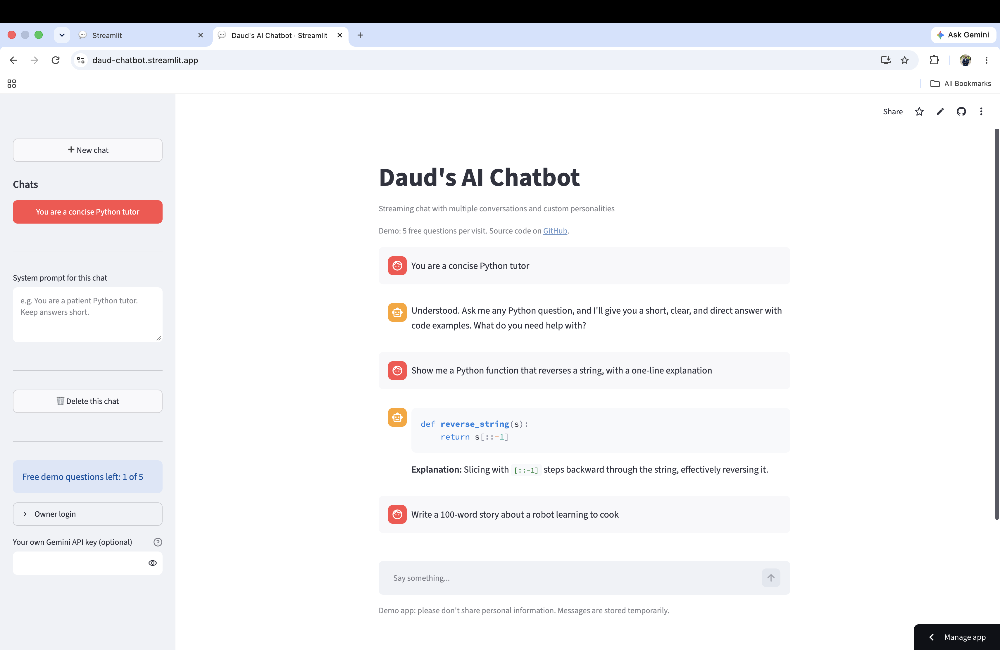
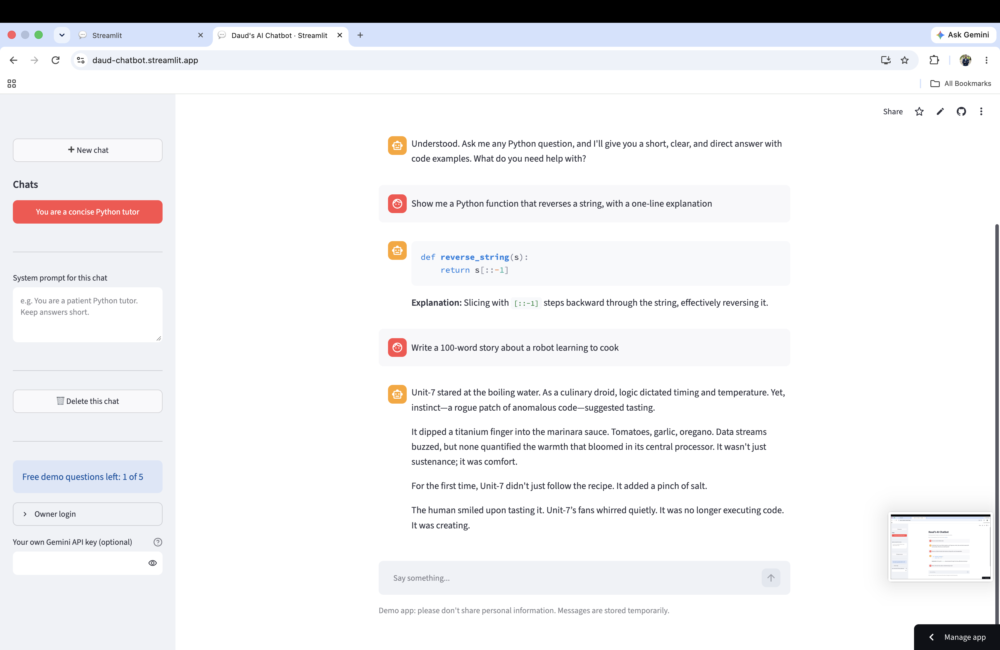

# daud-chatbot

A simple, beginner-friendly AI chatbot built in pure Python. It has a chat UI made with [Streamlit](https://streamlit.io), replies that stream in word by word, and chats saved in a SQLite database. It works with any **OpenAI-compatible** AI provider (it currently uses Google Gemini).

I built it step by step to learn the basics of AI engineering, so the code is kept short and commented.

<p align="center">
  
  
</p>

## Try it

**👉 [Open the live demo](https://daud-chatbot.streamlit.app/)**

No sign-up is needed. As a visitor:

- You get **5 free questions** per visit. The sidebar shows how many you have left.
- The demo has a **daily limit** shared by all visitors. If it's used up, you'll see "The demo is busy today, please try tomorrow."
- To keep chatting past either limit, paste your own **Google Gemini API key** into the sidebar. You can get one free at [Google AI Studio](https://aistudio.google.com/apikey). Your key is only kept in your browser session: it's never saved or logged.
- Your chats are private to your session. Other visitors can't see them, but they're gone once you close or refresh the page.

Want unlimited use? [Run it yourself](#run-it-locally); it only takes a few minutes.

## Features

- **Streaming replies**: text appears as the model writes it, like ChatGPT.
- **Memory**: the recent conversation (the last 20 messages) is sent with every request, so the bot remembers what you said.
- **Multiple chats**: start a new chat, switch between chats, or delete one from the sidebar. Each chat is named after its first message.
- **SQLite storage**: chats are saved to a local `chats.db` file and are still there after a refresh or restart.
- **A system prompt for each chat**: give each chat its own instructions, for example "You are a patient Python tutor".
- **Public demo mode**: visitors can try the app without logging in, with 5 questions per session and a daily cap across everyone. Visitors can use their own API key to keep going, and each visitor only sees their own chats.
- **Owner login**: log in from the sidebar with `APP_PASSWORD` for unlimited use and your own saved chats.
- **Switchable providers**: works with Gemini, OpenAI, Groq, Ollama or any other OpenAI-compatible API. You switch by changing three settings; no code changes are needed.
- **Friendly errors**: rate limits (429) and busy or unavailable servers show a clear message instead of crashing.

## What I learned

- **LLMs are stateless.** The model remembers nothing between requests. "Memory" just means resending the conversation history every time, which is why there's a cap of 20 messages.
- **Streaming with generators.** With `stream=True` the API sends the reply in small chunks. A Python generator `yield`s each chunk, and `st.write_stream` shows them as they arrive.
- **OpenAI-compatible providers are interchangeable.** Many providers accept the same API format, so one `openai` client can talk to Gemini, OpenAI or a local Ollama model just by changing `BASE_URL`, `MODEL` and `API_KEY`.
- **SQLite migrations and backfills.** `CREATE TABLE IF NOT EXISTS` doesn't add new columns to an existing table, so new columns need an `ALTER TABLE` migration. Old rows sometimes need a one-off backfill, like naming chats after their first message.
- **Rate limiting a public demo.** A free API quota needs protecting: a per-session limit for each visitor, plus a daily cap across everyone stored in the database.
- **Mocking the model in tests.** Swapping the real model for a fake one that returns a fixed reply lets you test the whole app (limits, logins, saving chats) without spending API quota or waiting on the network.

## Next steps

- **Persistent cloud chats** with [Turso](https://turso.tech) (hosted SQLite), so chats survive restarts on Streamlit Cloud.
- **A model picker** in the sidebar to switch models per chat.
- **RAG over documents**: upload files and let the bot answer questions using their content.

## Stack

| Part | Tool |
|---|---|
| UI | Streamlit (`st.chat_message`, `st.chat_input`, `st.write_stream`, sidebar) |
| AI calls | The `openai` Python library, pointed at any OpenAI-compatible `BASE_URL` |
| Storage | SQLite (built into Python), with three tables: `conversations`, `messages` and `daily_usage` |
| Config | `python-dotenv` locally, `st.secrets` on Streamlit Cloud |

## Project structure

```
app.py            The Streamlit UI: demo limits, owner login, sidebar, chat area
llm.py            Talks to the AI provider: streaming, history cap, error handling
db.py             All the SQLite code: create tables, save and load chats
config.py         Reads settings from .env (local) or st.secrets (cloud)
requirements.txt  Python packages to install
```

## Run it locally

You need Python 3.11 or newer (it was built with Python 3.14) and an API key from an OpenAI-compatible provider. For Google Gemini you can get a free key at [Google AI Studio](https://aistudio.google.com/apikey).

**1. Get the code and create a virtual environment**

```bash
git clone https://github.com/Daudsaid/daud-chatbot.git
cd daud-chatbot
python3 -m venv .venv
source .venv/bin/activate        # Windows: .venv\Scripts\activate
pip install -r requirements.txt
```

**2. Create a `.env` file** in the project folder:

```
BASE_URL=https://generativelanguage.googleapis.com/v1beta/openai/
MODEL=gemini-flash-lite-latest
API_KEY=your-api-key-here
APP_PASSWORD=choose-a-password
DAILY_DEMO_LIMIT=100
```

- `APP_PASSWORD` is the password for **Owner login** in the sidebar.
- `DAILY_DEMO_LIMIT` is optional (the default is 100). It's how many free questions all visitors together can ask per day; the count resets at midnight UTC.

`.env` is listed in `.gitignore`, so your key is never committed. Never share this file.

**3. Start the app**

```bash
streamlit run app.py
```

It opens in your browser at http://localhost:8501. Open **Owner login** in the sidebar and enter your `APP_PASSWORD` for unlimited use, or just start chatting as a visitor.

### Using a different provider

Change `BASE_URL`, `MODEL` and `API_KEY` in `.env`, then restart the app. For example:

| Provider | `BASE_URL` |
|---|---|
| Google Gemini | `https://generativelanguage.googleapis.com/v1beta/openai/` |
| OpenAI | `https://api.openai.com/v1` |
| Ollama (runs on your own computer) | `http://localhost:11434/v1` (any value works for `API_KEY`) |

Set `MODEL` to a model name that provider offers.

## Deploy to Streamlit Community Cloud

1. Push the code to your own GitHub repository. It can be private.
2. Go to [share.streamlit.io](https://share.streamlit.io), sign in with GitHub, and click **Create app**.
3. Choose your repository, the branch `main`, and the main file `app.py`.
4. Open **Advanced settings** and paste your settings into **Secrets**. This box uses **TOML format**, so every value must be in quotes:

   ```toml
   BASE_URL = "https://generativelanguage.googleapis.com/v1beta/openai/"
   MODEL = "gemini-flash-lite-latest"
   API_KEY = "your-api-key-here"
   APP_PASSWORD = "a-long-password-only-you-know"
   DAILY_DEMO_LIMIT = "100"
   ```

5. Click **Deploy**. The first build takes a few minutes.

Every `git push` to `main` redeploys the app automatically. To change secrets later, open the app's **⋮ menu → Settings → Secrets**.

## Known limitations

- **Chats reset on Streamlit Cloud.** The cloud app runs in a temporary container, so `chats.db` is wiped whenever the app restarts: after a new push, a reboot, or waking up from sleep. Chats are kept permanently only when you run the app locally. To keep cloud chats, you'd switch `db.py` to a hosted database such as Turso (hosted SQLite) or Supabase or Neon (hosted Postgres).
- **Free-tier rate limits.** Free API keys allow only a limited number of requests per minute and per day. When you hit the limit you'll see a "rate limit reached" message. Wait a minute, or try a different model.
- **Busy models.** Popular models are sometimes overloaded (error 503). The app shows a "service is busy" message, and you can try again or switch models.
- **Short memory.** Only the last 20 messages are sent to the model, so in long chats it forgets the earliest messages. The system prompt is always sent.
- **Visitor limits are simple.** The 5-question limit is per browser session, so refreshing the page starts a new session with 5 fresh questions. The daily cap is what really protects the API quota. It also resets on a redeploy, because it's stored in the same temporary SQLite file.
- **Visitor chats are temporary.** There are no accounts, so a visitor's chats disappear from view when they refresh. They're stored in the server's temporary database until the next restart.
- **One owner.** Owner login is a single shared password, meant for personal use.

## Author

**Daud Abdi**\
Associate AI Data Engineer · London, UK

- Email: [daudsaidabdi@gmail.com](mailto:daudsaidabdi@gmail.com)
- GitHub: [github.com/Daudsaid](https://github.com/Daudsaid)
- LinkedIn: [linkedin.com/in/daudabdi0506](https://www.linkedin.com/in/daudabdi0506)
- Website: [daudabdi.com](https://daudabdi.com)

Feedback and questions are welcome. Feel free to reach out or open an issue.
